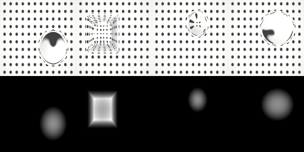

# Visuotactile

## Description

Visuotactile (GelSight-style) rendering performance benchmark. Four gel pads with different orientations (flat, 30 and 60 degree tilts, vertical) are loaded by spring-pressed primitive indenters (sphere, box, capsule, ellipsoid), so every sensor carries a sustained contact while the simulation steps. Each pad is also a MuJoCo tactile sensor, which `--function=visuotactile` turns into a `VisuotactileRenderer` at the requested resolution.

See [`validate.py`](validate.py) for the correctness checks: cross-validation of the rendered depth against MuJoCo C tactile sensors, tape-vs-finite-difference gradients, and throughput.

### visuotactile

Simultaneous depth/RGB rendering of four tactile sensors while stepping physics.

| Property | Value |
|----------|-------|
| Bodies | 9 |
| DoFs | 8 |
| Geoms | 13 |
| Tactile sensors | 4 |
| Resolution | 120x160 per sensor |
| Worlds | 4096 |



RGB (marker lattice) on the top row and depth on the bottom row, one column per sensor (sphere, box, capsule, ellipsoid indenters).

## Usage

```bash
# through the benchmark runner (GPU required)
uv run python benchmarks/run.py -f visuotactile

# directly, with control over resolution and worlds
uv run mjwarp-testspeed benchmarks/visuotactile/scene.xml \
  --function=visuotactile --visuotactile_height=120 --visuotactile_width=160 --nworld=4096

# correctness demo (works on CPU, writes rollout.png)
uv run python benchmarks/visuotactile/validate.py --steps 200 --res 128 --nworld 64
```

`validate.py` output on a development machine (Apple CPU, 128x128 per sensor), after 200 steps:

```
cross-validation against MuJoCo C tactile sensors
  sensor 0:  525 taxels, c_max 0.001568 m, ours_max 0.001567 m, max|diff| 1.858e-05 m, mean|diff| 2.408e-07 m, active 64
  sensor 1:  525 taxels, c_max 0.002823 m, ours_max 0.002782 m, max|diff| 1.084e-04 m, mean|diff| 9.410e-07 m, active 100
  sensor 2:  525 taxels, c_max 0.001550 m, ours_max 0.001549 m, max|diff| 2.003e-05 m, mean|diff| 1.640e-07 m, active 34
  sensor 3:  525 taxels, c_max 0.001548 m, ours_max 0.001548 m, max|diff| 6.644e-06 m, mean|diff| 1.175e-07 m, active 68
  total: 2100 taxels compared, 266 active, worst |diff| 1.084e-04 m
gradient check (taxel 86,70 of sensor 0, geom 2 'pad0_gel', depth 0.3999 mm)
  tape d(depth)/dxpos [0.6487632 0.1766268 0.740209 ]
  finite diff         [0.64866617 0.17660204 0.74121635 ]
  max relative difference 1.359e-03
```

The residual depth difference against MuJoCo C is bilinear interpolation of the rendered
grid at the taxel positions; it halves when the rendered resolution doubles.
